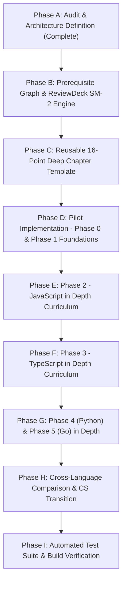

# Engineering Foundations & Review Deck: Comprehensive Curriculum Audit

**Date of Audit:** October 2026  
**Auditor:** Senior Software Engineer, Curriculum Architect & Language Specialist  
**Repository:** `Ujjwal-Gowda/review-deck`  
**Application:** Engineering Foundations (React 19 + TypeScript + Vite)

---

## 1. Verified Current Curriculum Structure

A physical inspection of the codebase reveals substantial discrepancies between documentation and actual implementation:

| Metric | Stated in `README.md` | Verified in Code (`src/curriculum.ts`, `src/structure.ts`) | Variance / Status |
| :--- | :--- | :--- | :--- |
| **Total Chapters** | 349 chapters | **388 chapters** defined in `const RAW` | +39 chapters unlisted in README |
| **Curriculum Parts** | 38 parts | **41 parts** (`0` to `XL`) | +3 parts unlisted in README |
| **Curriculum Stages** | 15 stages | **18 stages** in `STAGES` (`src/structure.ts`) | +3 stages unlisted in README |
| **Glossary Terms** | 287 terms | **287 terms** in `src/glossary.ts` | Accurate |
| **Content Files** | Not specified | **389 `.html` files** in `src/content/` | Verified |
| **Interactive Predict Challenges** | Implied across chapters | **20 challenges** in `learningWidgets.ts` | 94.8% of chapters lack widgets |
| **Knowledge Check Quizzes** | Implied across chapters | **13 quizzes** in `learningWidgets.ts` | 96.6% of chapters lack quizzes |
| **Review Deck Cards** | Implied full-curriculum deck | **13 static mock cards** in `ReviewDeck.tsx` | No active scheduling |

### Verified Curriculum Partition Map (41 Parts)

```
Stage 0: Learn how to learn
  Part 0: Learning Methodology (1 ch: c00)

Stage 1: How a computer works
  Part I: Computing (4 ch: c01, n02, n03, n04)

Stage 2: Core programming
  Part II: Programming (10 ch: c02, c03, c04, c05, n11, c06, c07, c08, c09, n16)

Stage 3: The modern polyglot
  Part III: Languages: Shared Concepts (13 ch: c33, x-lang-toolchains, x-lang-vars, x-lang-control, x-lang-functions, x-lang-collections, x-lang-strings, x-lang-types, x-lang-errors, x-lang-modules, x-lang-memory, x-lang-concurrency, x-lang-io)
  Part IV: Python (10 ch: c34, x-py-cheat, x-py-basics, x-py-flow, x-py-collections, x-py-oop, x-py-errors-io, x-py-iter, x-py-packaging, x-py-concurrency)
  Part V: TypeScript (9 ch: c35, x-ts-cheat, x-ts-basics, x-ts-flow, x-ts-collections, x-ts-types, x-ts-errors-io, x-ts-async, x-ts-tooling)
  Part VI: Go (9 ch: c36, x-go-cheat, x-go-basics, x-go-flow, x-go-collections, x-go-types, x-go-errors, x-go-concurrency, x-go-tooling)

Stage 4: The developer's workbench
  Part VII: Linux (8 ch: c17, n53-n59)
  Part VIII: Git & Collaboration (9 ch: n43-n51)

Stage 5: Computer science & foundations
  Part IX: Computer Science (5 ch: n20, n21, c10, c12, c11)
  Part X: Data Structures & Algorithms (22 ch: x-dsa-intro to x-dsa-choose)

Stage 6: Software engineering & architecture
  Part XI: Software Engineering (14 ch: c21, n34, c13, c14, c18, n25, n35-n38, c15, n40-n42)

Stage 7: Systems & low-level programming
  Part XII: Systems & OS Internals (6 ch: c22, x-linking, c23, x-io, c20, n27)
  Part XIII: C (10 ch: c38, x-c-cheat, x-c-basics, x-c-pointers, x-c-structs, x-c-strings, x-c-functions, x-c-memory, x-c-io, x-c-preproc)
  Part XIV: Rust (10 ch: c37, x-rs-cheat, x-rs-basics, x-rs-ownership, x-rs-types, x-rs-traits, x-rs-collections, x-rs-errors, x-rs-concurrency, x-rs-tooling)

Stage 8: How networks work
  Part XV: Networking & the Web (13 ch: n61-n67, n68 [JS], n69 [TS], n70, x-lb, x-subnet)

Stage 9: How applications work
  Part XVI: Frontend (9 ch: n71-n79)
  Part XVII: Backend (12 ch: n80-n91)
  Part XVIII: Databases (14 ch: c25, n93-n104, x-dbtest)
  Part XIX: Testing (11 ch: c16, n106-n111, x-teststrategy, x-apitest, x-prodtest)

Stage 10: How software ships
  Part XX: Docker (8 ch: c24, n112-n118)
  Part XXI: CI/CD (7 ch: n119-n125)
  Part XXII: Cloud (9 ch: n126-n134)
  Part XXIII: Kubernetes (12 ch: n135-n146)
  Part XXIV: Infrastructure (7 ch: n147-n153)

Stage 11: How production systems run
  Part XXV: Observability (8 ch: n154-n161)
  Part XXVI: Production Engineering (4 ch: x-path, x-health, x-prodready, x-operate)
  Part XXVII: Security (8 ch: x-secmap, n163-n168, x-ratelimit)
  Part XXVIII: Performance (7 ch: n186-n192)

Stage 12: How distributed systems work
  Part XXIX: Distributed Systems (9 ch: c26, n169-n176)
  Part XXX: System Design (8 ch: n177-n184)

Stage 13: How AI systems work
  Part XXXI: Machine Learning (8 ch: c27, n194-n200)
  Part XXXII: LLMs (8 ch: c29, n201, n203-n207, c31)
  Part XXXIII: RAG (7 ch: n210-n215, c30)
  Part XXXIV: AI Engineering (12 ch: c28, n217-n226, c32)
  Part XXXV: MLOps (7 ch: n227-n234)

Stage 14: Build and practise
  Part XXXVI: Projects (12 ch: n235-n246)
  Part XXXVII: Engineering Practice (9 ch: n247-n254, x-datamodels)

Stage 15: AI in your product
  Part XXXVIII: AI Integration in Apps (14 ch: ai-overview to ai-feature-flags)

Stage 16: Getting paid
  Part XXXIX: Payment Gateways (13 ch: pay-fundamentals to pay-others)

Stage 17: Building a SaaS
  Part XL: Practical SaaS Engineering (12 ch: saas-architecture to saas-launch)
```

---

## 2. Existing Programming-Language Content Audit

### A. JavaScript: The Critical Void
- **Finding:** JavaScript has **zero dedicated parts** in the 41-part curriculum.
- **Location:** It appears only as a single chapter: `n68.html` ("JavaScript") tucked inside **Part XV: Networking & the Web** (Chapter index ~171).
- **Quality of `n68.html`:** Exactly 33 lines of HTML. It attempts to explain closures, `this` binding, prototypes, ECMAScript modules vs CommonJS, the event loop and microtask queue, `Promise.all`/`race`/`allSettled`, `AbortController`, `structuredClone`, `Number.MAX_SAFE_INTEGER`, and `eval` inside a single page.
- **Pedagogical Failure:** There is zero chance a learner develops genuine JavaScript fluency, mental models of the V8 event loop, asynchronous task management, or Node.js server capability from 33 lines of summary text placed 120 chapters after TypeScript was already introduced.

### B. TypeScript: Conflated and Premature
- **Finding:** TypeScript is taught in Part V (Chapters ~49–57), **long before JavaScript is ever taught** (Part XV).
- **Conflation:** `c35.html` and `x-ts-basics.html` repeatedly conflate JavaScript runtime behaviors with TypeScript:
  - Discusses JavaScript type coercion (`0 == ""`, `[]` being truthy, `typeof null === "object"`, array `.sort()` sorting numbers lexicographically) inside TypeScript chapters.
  - Leaves the impression that these quirks belong to TypeScript rather than being inherited from the underlying JavaScript runtime.
- **Stale Code Artifact:** `c35.html` line 7 contains a stale copy-paste artifact: `"Your Remotion film is TS + React"`.
- **Missing Depths:** Lacks systematic derivations of mapped and conditional types, distributive types, runtime validation boundaries (Zod/Valibot) vs compile-time erasure, and backend Node.js typing patterns.

### C. Python: Good Outline, Superficial Depth
- **Finding:** Part IV contains 10 chapters (`c34`, `x-py-cheat`, `x-py-basics`, `x-py-flow`, `x-py-collections`, `x-py-oop`, `x-py-errors-io`, `x-py-iter`, `x-py-packaging`, `x-py-concurrency`).
- **Deficiencies:**
  - Explanations are predominantly high-level bullet summaries rather than step-by-step state traces.
  - Lacks concrete execution order diagrams for CPython bytecode and frame evaluation (`ceval.c`).
  - Reference counting vs cyclic GC is mentioned in one sentence without visual memory diagrams.
  - Missing structured asynchronous programming exercises with cancellation tokens, task groups, and exception groups (Python 3.11+).

### D. Go: Missing Critical Memory & Concurrency Nuances
- **Finding:** Part VI contains 9 chapters (`c36`, `x-go-cheat`, `x-go-basics`, `x-go-flow`, `x-go-collections`, `x-go-types`, `x-go-errors`, `x-go-concurrency`, `x-go-tooling`).
- **Deficiencies:**
  - `x-go-collections.html` mentions `len` and `cap`, but does not diagram the internal 3-word slice header (`Data *T, Len int, Cap int`) and how sub-slicing shares backing array memory until `append` triggers reallocation.
  - The nil interface trap (where an interface holding a typed `(*MyType)(nil)` pointer is NOT equal to `nil`) is omitted or obscured.
  - Concurrency chapters describe goroutines as "cheap threads" without tracing scheduling states ($M:N$ scheduler: OS threads $M$, logical processors $P$, goroutines $G$), channel deadlock conditions, or worker pool backpressure patterns.

### E. Languages Shared Concepts (Part III)
- Contains 13 chapters attempting to compare 5 languages (Python, TS, Go, Rust, C).
- **Issue:** It focuses heavily on syntactic side-by-side Rosetta translations rather than deep semantics (e.g. value vs reference semantics, stack vs heap allocation, garbage collector latencies vs manual RAII).

---

## 3. Missing or Weak Prerequisites

1. **Missing Phase 0 ("Learn How to Learn Programming"):**
   - The current curriculum opens with `c00.html` ("Learning to Program in the AI Era"). While `c00` discusses spaced repetition and AI pitfalls, it provides zero instruction on:
     - How to break a fuzzy requirement into inputs, outputs, and deterministic constraints.
     - Writing structured pseudocode before opening an IDE.
     - Manually tracing variable state across iterations on paper.
     - Reading and diagnosing compiler errors vs runtime exceptions.
     - Systematic bisection debugging vs random trial-and-error.
2. **Missing JavaScript Foundations for TypeScript:**
   - As noted, TypeScript cannot be properly understood without first mastering JavaScript expressions, prototype chains, closures, execution contexts, and the event loop.
3. **Premature Low-Level Systems in Early Computing:**
   - Part I ("Computing") introduces C-style machine code, registers, and assembly before the learner can write a simple conditional or loop in any high-level language.

---

## 4. Topics That Are Out of Order

| Problematic Placement | Current Location | Correct Pedagogical Location | Rationale |
| :--- | :--- | :--- | :--- |
| **JavaScript** | Part XV (Ch 171) in Networking | **Phase 2 (Immediate post-foundations)** | JavaScript is the foundational runtime for TypeScript, Node.js, and web systems. |
| **TypeScript** | Part V (Ch 49–57) before JS | **Phase 3 (Directly following JavaScript)** | TypeScript is an erased type system over JavaScript; teaching it first creates chronic mental model confusion. |
| **Python** | Part IV (Ch 38–47) | **Phase 4 (After JS/TS mastery)** | Clean transition to dynamic object models, duck typing, and CPython internals. |
| **Go** | Part VI (Ch 58–66) | **Phase 5 (After Python)** | Provides the ideal transition to static typing, explicit compilation, and systems-level concurrency. |
| **Computer Science & Advanced OS** | Part IX & XII | **Phase 6+ (After 4-language fluency)** | CS algorithms, memory hierarchy, and systems concepts are far better understood when learners can implement them in Go, Python, or TS. |

---

## 5. Chapters Needing Splitting or Deeper Explanations

1. **`n68` (JavaScript):** Must be decommissioned from its single-chapter form and split into a full, multi-part, 4-module curriculum:
   - Module A: Language Fundamentals (primitives, operators, coercion, hoisting, scope, closures).
   - Module B: Object Model & Prototypes (identity, descriptors, prototypes, classes, `this` binding, maps/sets).
   - Module C: Asynchronous JavaScript (call stack, execution contexts, event loop, tasks/microtasks, Promises, `async`/`await`, `AbortController`).
   - Module D: Practical & Node.js JavaScript (CommonJS vs ESM, Node streams, file handling, HTTP servers, testing, security).
2. **`c35` & `x-ts-*` (TypeScript):**
   - Split compile-time type mechanics from runtime JavaScript execution.
   - Dedicate a deep chapter to runtime boundary validation (Zod, schema parsing, untrusted data validation) vs compile-time types.
3. **`x-go-concurrency`:**
   - Split into two chapters: (1) Channels, goroutines, and select; (2) Synchronization primitives (`sync.Mutex`, `sync.RWMutex`, `sync.WaitGroup`, atomic operations, and context cancellation).
4. **`x-py-concurrency`:**
   - Split into (1) The GIL, threads, and processes; (2) `asyncio` event loop, tasks, structured concurrency, and async context managers.

---

## 6. Existing Functionality Worth Preserving

1. **Vite + React 19 Single Page Architecture:**
   - Blazing fast compilation, HMR, and small bundle size.
   - Dynamic HTML imports via `import.meta.glob("./content/*.html", { query: "?raw", import: "default" })`.
2. **Stable Content Keys (`<a class="xref" data-old="...">`):**
   - Cross-chapter references resolve dynamically via `KEY_TO_CH` map, allowing chapters and parts to be reordered or added without broken hyperlinks.
3. **Reader Customizations:**
   - Zen / Focus Mode (`Z`), Font Size scaling (Aa), Serif / Sans font toggle, Light / Dark theme toggle.
   - Keyboard navigation (`←` / `→` for chapters, `⌘K` for Command Palette, `[` for sidebar).
4. **Interactive Widgets:**
   - PredictWidget (`Rule 3: Predict then run`).
   - KnowledgeCheck quiz components.
   - NotesDrawer and localStorage persistence.
   - Executive ChapterDigest with topic checklist and Markdown export.
5. **Generative SVG Stage Artwork (`src/Art.tsx`):**
   - Procedurally generated visual motifs seeded per chapter.

---

## 7. Technical Inaccuracies & Contradictions Discovered

1. **`ReviewDeck.tsx` Mock Spaced Repetition:**
   - Lines 184–190: Clicking "Review Soon" and "Mastered" call the exact same function: `handleNext()`.
   - `handleNext()` merely advances `(currentIndex + 1) % cards.length`.
   - There is no calculation of due dates, no ease factor adjustment, no retention intervals (1d / 7d / 30d), and no persistence in `localStorage`.
   - **Remediation Required:** Implement a verified Leitner or SuperMemo-2 (SM-2) scheduling algorithm with persistent card states, history logs, and automated tests.
2. **Copy-Paste Artifacts in Content:**
   - `src/content/c35.html` contains: *"Where it runs: browsers, Node.js, Deno, Bun. Your Remotion film is TS + React."* (stale artifact from another project).
3. **Type Coercion Attribution in TypeScript Chapter:**
   - `c35.html` describes `[] + {}` and `0 == ""` under TypeScript traps without clarifying that TypeScript's compiler actively flags these in strict mode, and that they are purely runtime quirks of JavaScript.

---

## 8. Proposed Phased Implementation Sequence



- **Phase A (Immediate):** Complete verified audit and implementation progress ledger.
- **Phase B:** Overhaul `ReviewDeck.tsx` to implement true SuperMemo-2 / Leitner spaced repetition with stable IDs, due dates, review history, and unit tests using `vitest`.
- **Phase C:** Establish the 16-point deep pedagogical chapter format and author helper utilities.
- **Phase D:** Implement Phase 0 ("Learn How to Learn Programming") and Phase 1 ("Shared Programming Foundations") with step-by-step state tracing, predictor widgets, and failure case drills.
- **Phase E:** Build out the dedicated Phase 2 JavaScript in Depth curriculum (Language Fundamentals, Objects & Prototypes, Asynchronous Engine, Practical Node.js) with 6 progressive mastery projects.
- **Phase F:** Revise Phase 3 TypeScript in Depth to establish compile-time vs runtime boundaries, structural typing, and runtime validation.
- **Phase G:** Deepen Phase 4 (Python) and Phase 5 (Go) with runtime models, memory mechanics, and concurrency architectures.
- **Phase H:** Integrate comparative tracks and seamless bridge to Computer Science.
- **Phase I:** Full build and test verification across all modules.
